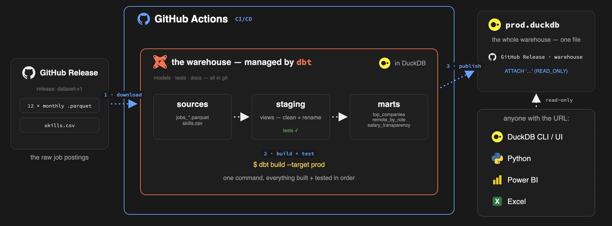
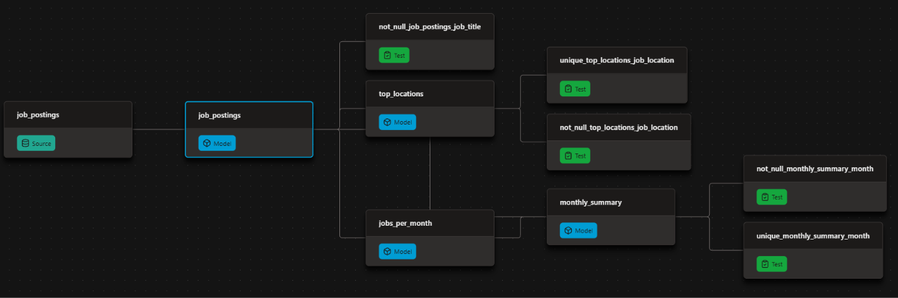

# Automated Job Postings Pipeline - dbt + DuckDB

[](https://github.com/Matt-60/dbt-duckdb-pipeline/actions/workflows/dbt_build.yml)
[](https://matt-60.github.io/dbt-duckdb-pipeline/)



A public dbt + DuckDB pipeline over real job postings, rebuilt and republished automatically by GitHub Actions.

- Models raw postings into tested, documented insight marts
- Publishes the docs site and the finished warehouse — open to anyone, no credentials
- Runs itself on GitHub Actions: every push to `master`, every Monday, or on demand

| What I Built | How I Implemented | Where to Look |
| --- | --- | --- |
| **dbt pipeline** | source → cleaned view → insight marts | [`analytics/models/`](analytics/models/) |
| **Data tests** | `unique` / `not_null` on mart grains | [`schema.yml`](analytics/models/schema.yml) |
| **Hosted dbt docs** | lineage, descriptions, column tests | [Live docs site](https://matt-60.github.io/dbt-duckdb-pipeline/) |
| **CI/CD** | build + test + publish on GitHub Actions | [Actions workflow](https://github.com/Matt-60/dbt-duckdb-pipeline/actions/workflows/dbt_build.yml) |
| **Profile** | committed DuckDB `prod` target | [`analytics/profiles.yml`](analytics/profiles.yml) |
| **Published warehouse** | one `ATTACH`, queryable by anyone | [Query it](#-query-the-published-warehouse) |

---

## ⚙️ The dbt Pipeline

Raw parquet files are declared as a dbt source, cleaned in a single staging view, and aggregated into marts — with tests gating every build:



| Model | Materialization | What it is |
| --- | --- | --- |
| `job_postings` | view | Cleaned postings — scraper error rows removed |
| `jobs_per_month` | table | Posting counts per month and search role |
| `monthly_summary` | table | One row per month: total vs remote postings, % remote |
| `top_locations` | table | Top 10 locations by posting count |

The dbt features doing the work:

| dbt Feature | How I Used It |
| --- | --- |
| Declared sources (no hardcoded paths in models) | [`sources.yml`](analytics/models/sources.yml) + `source('raw', 'job_postings')` |
| Model dependencies | `ref()` everywhere downstream; `monthly_summary` reads two parents (a diamond in the DAG) |
| Materializations | project default `table`; staging override to `view` |
| Data tests | `unique` / `not_null` in [`schema.yml`](analytics/models/schema.yml) |
| Documentation | model and column descriptions persisted to the warehouse (`persist_docs`) |

`dbt build` compiles SQL, materializes models, and fails the run if any test fails — the same command locally and in CI.

---

## 🚀 Production

GitHub Actions runs the whole pipeline — no laptop required: [`.github/workflows/dbt_build.yml`](.github/workflows/dbt_build.yml)

| Trigger | What happens |
| --- | --- |
| Push to `master` | Full rebuild |
| Weekly (Monday, 06:00 UTC) | Scheduled rebuild |
| Manual (`workflow_dispatch`) | Run button in the Actions tab |

On each run, Actions:

1. Installs dependencies with `uv`
2. Downloads the raw parquet files into `analytics/data/raw/`
3. Runs `dbt build` with the committed profile (`prod` target)
4. Publishes `prod.duckdb` as the `warehouse` GitHub Release asset

---

## 🦆 Query the published warehouse

No clone required. [Install DuckDB](https://duckdb.org/docs/installation/) (`winget install DuckDB.cli` on Windows, `brew install duckdb` on macOS), then in a `duckdb` session:

```sql
INSTALL httpfs;
LOAD httpfs;

ATTACH 'https://github.com/Matt-60/dbt-duckdb-pipeline/releases/download/warehouse/prod.duckdb' AS jobs;
USE jobs;
SHOW TABLES;

SELECT * FROM top_locations;
SELECT * FROM monthly_summary;
```

> `job_postings` is a view over the raw parquet files, so it only works where those files exist (locally or in CI). The mart tables above are self-contained.

---

## 📖 Docs

The dbt docs site is served by GitHub Pages from the [`docs/`](docs/) folder:

**→ [matt-60.github.io/dbt-duckdb-pipeline](https://matt-60.github.io/dbt-duckdb-pipeline/)**

It shows:

- The full **lineage graph** (source → staging view → marts)
- **Model and column descriptions** from the YAML
- Which columns carry **tests**

The site is generated locally with `dbt docs generate` and committed to `docs/` — regenerate and commit it after changing models or descriptions.

---

## 💻 Run it yourself

```bash
uv sync
uv run python scripts/download_data.py   # → analytics/data/raw/ (~85 MB)
cd analytics
uv run dbt build
```

The warehouse lands in `analytics/data/prod.duckdb`. Browse it with:

```bash
duckdb -readonly data/prod.duckdb
```

To preview the docs site locally:

```bash
python -m http.server 8000 -d docs   # then open http://localhost:8000
```

---

## 📁 Project layout

```text
.
├── .github/workflows/dbt_build.yml   # CI: build, test, publish
├── analytics/                        # dbt project
│   ├── dbt_project.yml
│   ├── profiles.yml                  # DuckDB prod target
│   ├── data/                         # raw parquet + prod.duckdb (gitignored)
│   └── models/                       # sources, models, schema.yml
├── docs/                             # dbt docs site (GitHub Pages)
├── img/                              # README diagrams
└── scripts/download_data.py          # fetch raw parquet before build
```

---

*Built as Project #1 of the [dbt for Data Analytics & Engineering course](https://www.lukebarousse.com) by Luke Barousse. Dataset: real job postings, provided by the course.*